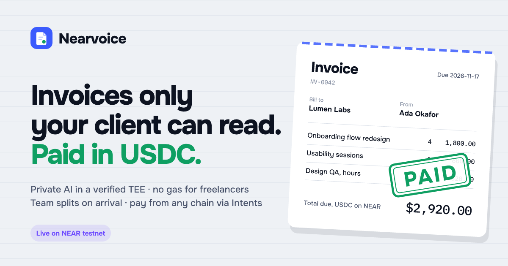

<p align="center"></p>

# Nearvoice

**Private invoices that get paid in stablecoins, without the freelancer ever touching crypto.**

[Live app](https://nearvoice.vercel.app) · [Demo video](https://github.com/jayplume/nearvoice/releases/download/v0.2.0/nearvoice-demo.mp4) · [Architecture](docs/ARCHITECTURE.md) · [Security model](docs/SECURITY.md) · [Testing](docs/TESTING.md) · [Self-audit](docs/AUDIT.md)



This page is written for the person who keeps the books.

## What it does, in plain words

1. **A freelancer writes an invoice.** Type the work in your own words ("3 days of logo design at $400 a day, rush fee $150, due 1 December") and a private AI turns it into line items. You check it, set a due date, and get a link.
2. **The client opens the link and pays.** They see the invoice, connect a wallet and pay in USDC. If their money sits on another chain (Base, Arbitrum, Solana, Ethereum), the page shows exactly what they would send from there.
3. **You get paid, already split.** The payment lands in USDC on NEAR and is divided the way you set it up: for example 80% to you, 15% to a tax reserve, 5% to a collaborator.
4. **Your accountant gets a CSV.** One row per invoice: number, client, issue date, due date, paid date, amount, currency, status, and the transaction link that proves it.

## What a bookkeeper should know

| Question | Answer |
|---|---|
| Who can see an invoice? | Only people with the link. The invoice details are encrypted in the browser before they are stored; the public record holds only the amount owed, the currency, the status and a fingerprint of the details. |
| Is "paid" trustworthy? | Yes. An invoice is marked paid only by the payment itself, in the same transaction, and every status links to that transaction on a public explorer. |
| Can a paid invoice be reversed? | Yes, as a refund: the freelancer sends the money back through the invoice, and its status becomes "refunded" with a link to that transaction. |
| Does the freelancer need crypto? | No. The account is created for them and every action they take is paid for by Nearvoice's relayer. |
| What currency? | USDC (on this test network, a test version of it). Amounts are kept in whole cents. |
| Who saw my invoice text when the AI read it? | Nobody: it runs on NEAR AI Cloud inside a sealed hardware enclave (TEE). The app checks the enclave's hardware attestation each time and shows what was checked. Nothing is stored after the answer returns. |

## What is stored, and where

Nothing about an invoice is stored on Nearvoice's servers. There is no database: the four server functions (`api/`) create accounts, pay gas, forward one AI request and relay two hardware verdicts, and keep nothing after they answer. The invoice lives on NEAR as ciphertext plus a fingerprint; its key lives in the link and in the freelancer's browser.

## Status of this build

Runs on NEAR **testnet** with test USDC. No real money moves. Anyone can take 1,000 test USDC from the faucet on an invoice page.

| Piece | Where |
|---|---|
| Invoice contract | [`invoices.nearvoice.testnet`](https://testnet.nearblocks.io/address/invoices.nearvoice.testnet) |
| Test USDC (NEP-141, 6 decimals, faucet) | [`usdc.nearvoice.testnet`](https://testnet.nearblocks.io/address/usdc.nearvoice.testnet) |
| Relayer and account parent | [`nearvoice.testnet`](https://testnet.nearblocks.io/address/nearvoice.testnet) |
| Private model | `deepseek-ai/DeepSeek-V4.1-Flash-1017` on NEAR AI Cloud (Intel TDX + NVIDIA confidential GPUs) |

**A real payment, end to end.** Invoice #5 ($820 from Ada Okafor Studio to Lumen Labs, split 80/20) was drafted by the private model, sealed and recorded gaslessly, then paid from a Meteor wallet (`itup.testnet`). One transaction moved 820 test USDC into the contract, marked the invoice paid and paid 656 to `ada-okafor.nearvoice.testnet` and 164 to `kofi-mensah.nearvoice.testnet`: [Cxfx5HVc…BbBn3v](https://testnet.nearblocks.io/txns/Cxfx5HVcooUp7MpFJWsiVjTAqSA65yDMug4sD1BbBn3v).

---

## For developers

```bash
nvm use                      # Node 22+
pnpm install
cp .env.example .env         # NEARAI_API_KEY; RELAYER_KEY or a NEAR CLI credential for nearvoice.testnet
pnpm dev:api                 # the Vercel functions on :3000
pnpm dev                     # the app on :5176
pnpm check                   # lint, types, tests
```

```
contracts/invoices   Rust: invoices, payment and splits, refunds, kill switch, events
contracts/usdc       Rust: NEP-141 test stablecoin with a faucet
packages/core        TypeScript shared by browser and server: money, sealing, CSV, 1Click, attestation, signatures, relay policy
api/                 Vercel functions: onboard, relay, ai, attest
apps/web             React 19 + Vite app, light and dark
scripts/             deploy, end-to-end testnet run, API smoke test, local API server
```

| Built with | For |
|---|---|
| near-sdk 5 (Rust), NEP-141, NEP-297 | contracts, token, events |
| NEP-366 meta transactions, near-api-js 7 | gasless freelancer accounts |
| NEAR AI Cloud | private model, TDX + GPU attestation, signed responses |
| NEAR Intents 1Click API | pay-from-any-chain quotes |
| NEAR Wallet Selector 10 (Meteor, Intear, HERE, Sender) | client payments |
| Web Crypto (AES-256-GCM, SHA-256), @noble/curves | sealing, signature recovery |
| Phala DCAP verifier, NVIDIA NRAS | hardware attestation verdicts |
| NearBlocks API v3 | transaction proof for every status |
| React 19, Vite 7, TanStack Query, Motion, zod, Vitest, Testing Library, Biome | app and tooling |

Licensed MIT.
