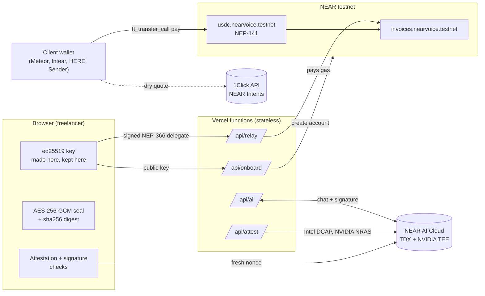

# Architecture

Nearvoice has three parts: two Rust contracts on NEAR, four stateless server functions, and a React app that does all the cryptography in the browser.

## The invoice, end to end

1. **Account.** The browser generates an ed25519 key. `/api/onboard` creates `<handle>.nearvoice.testnet` with that public key as its only full-access key, funded with 0.02 NEAR for its own storage. Only a parent can create a sub-account on NEAR, so the relayer is `nearvoice.testnet` itself.
2. **Drafting.** The browser picks a random 32-byte nonce and fetches NEAR AI Cloud's attestation report for it directly (the endpoint allows CORS). It checks, for the gateway and each model enclave, that the report echoes the nonce, that the Intel TDX quote's `report_data` commits to the enclave's signing address and the nonce, that the quote is a TDX quote (TEE type `0x81`), and that the NVIDIA evidence carries the nonce. `/api/attest` relays the two checks a browser cannot make (Intel's DCAP verifier via Phala and NVIDIA's NRAS do not allow cross-origin calls). `/api/ai` then sends the notes to the private model and returns the exact request bytes, response bytes and the enclave's ECDSA signature over `model:sha256(request):sha256(response)`. The browser recomputes both hashes and recovers the signer (EIP-191, secp256k1), which must be one of the attested signing addresses.
3. **Sealing.** `packages/core/src/seal.ts` serialises the invoice details as canonical JSON (sorted keys), encrypts them with a fresh AES-256-GCM key and IV, and computes `sha256(canonical JSON)`. The chain gets `base64url(iv ‖ ciphertext)` and the digest; the key goes only into the link's `#k=` fragment, which browsers never send to a server.
4. **Recording.** The browser signs a NEP-366 `DelegateAction` calling `create_invoice` and posts it to `/api/relay`. The relayer decodes it with borsh, checks it against `relay-policy.ts` (receiver must be the invoice contract, sender must be a Nearvoice account, only `create_invoice`, `cancel_invoice` or `set_profile`, no deposit, at most 100 Tgas, at most 3 actions) and submits it, paying the gas.
5. **Paying.** The client's wallet calls `ft_transfer_call` on the USDC contract with `msg = {"pay": id}`. In `ft_on_transfer` the invoice contract checks the token, the status, the issuer's kill switch and the amount; marks the invoice paid; pays each split recipient with `ft_transfer`; and returns any excess, all within the client's single transaction. If a recipient's transfer fails, `on_payout` records the amount as claimable for that recipient instead of losing it.
6. **Reading.** The client page decrypts with the fragment key and recomputes the digest. If it does not match the chain, the page tells the client not to pay.

## Contracts (`contracts/`)

| Contract | Account | What it does |
|---|---|---|
| `invoices` | `invoices.nearvoice.testnet` | Invoices, payment and splits, refunds, cancellation, per-business profile (name, default split, invoice cap, pause), claimable balances, views, NEP-297 events (`invoice_created`, `invoice_paid`, `invoice_cancelled`, `invoice_refunded`, `profile_set`, `payout_held`) |
| `usdc` | `usdc.nearvoice.testnet` | A NEP-141 test stablecoin with 6 decimals, a 1,000-token faucet with a one-hour cooldown, and automatic storage registration |

Both use near-sdk 5.29. Amounts are `u128` token units; splits are basis points that must sum to 10,000; `split_amounts` floors each share and gives the remainder to the first recipient, so the parts always add up to the invoice exactly. The invoice contract has no owner and no admin methods; accepted tokens are fixed at initialisation.

## Server (`api/`)

Each file exports `POST(req: Request)`, the Web-standard signature Vercel runs. None stores anything. Secrets (`RELAYER_KEY`, `NEARAI_API_KEY`) come from the environment. `scripts/dev-api.ts` serves the same handlers on `localhost:3000` for development.

## Shared code (`packages/core`)

Everything that both the server and the browser need, and everything worth unit-testing. The app and local scripts use its TypeScript source (a Vite alias and the `source` export condition); the deployed functions use its compiled `dist/` (`pnpm build` compiles it first). It covers money (integer cents and token units, never floats), the zod invoice schema, sealing, CSV export, 1Click quotes, attestation checks, signature recovery and the relay policy.

## Web app (`apps/web`)

React 19, Vite 7, TanStack Query, Motion, NEAR Wallet Selector 10 and near-api-js 7. Routes load lazily, so the landing page does not download wallet code. A hand-written 50-line router covers six routes. Light and dark themes are designed separately (`styles/tokens.css`) and follow the system until the user picks one.

| Route | Page |
|---|---|
| `/` | Landing, with live contract stats |
| `/app` | Freelancer dashboard: onboarding, invoices, CSV export, business settings |
| `/app/new` | New invoice: private AI draft with proof, line editor, live preview, seal and send |
| `/i/:id#k=…` | Client view: decrypt, verify, pay, NEAR Intents quotes, split, history |
| `/verify` | Privacy proof: run the enclave checks, try the sealing, what is public |
| `/ledger` | Every invoice as a stranger sees it |

## Why NEAR

- **Named sub-accounts** let a freelancer have `ada.nearvoice.testnet` without a wallet app or a seed phrase.
- **NEP-366 meta transactions** let them act on chain without holding NEAR.
- **`ft_transfer_call`** makes payment and settlement one transaction, which is what lets the contract refuse a wrong amount instead of reconciling it later.
- **NEAR AI Cloud** gives the bookkeeping assistant hardware privacy that the browser can verify.
- **NEAR Intents** lets a client holding USDC on Base or Solana pay an invoice billed in USDC on NEAR.
